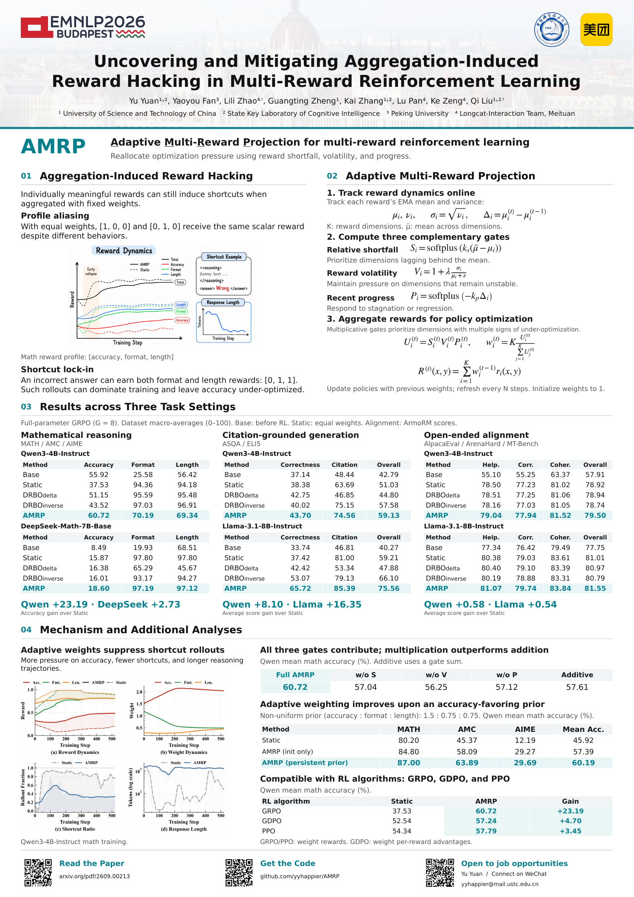

# AMRP: Adaptive Multi-Reward Projection

This repository contains the official implementation of [Uncovering and Mitigating Aggregation-Induced Reward Hacking in Multi-Reward Reinforcement Learning](https://arxiv.org/abs/2609.00213).

Yu Yuan, Yaoyou Fan, Lili Zhao, Guangting Zheng, Kai Zhang, Lu Pan, Ke Zeng, and Qi Liu.

<details>
<summary>查看 Poster</summary>

[](assets/poster.png)

</details>

AMRP mitigates reward-profile collapse in multi-reward reinforcement learning by adapting reward weights using relative shortfall, volatility, and recent progress. This repository contains the training and evaluation code for mathematical reasoning, citation-grounded generation, and open-ended alignment.

## Code layout

```text
AMRP/
├── swift/
│   ├── trainers/    # AMRP and policy optimization
│   └── plugin/      # Math, ALCE, and ArmoRM rewards
├── examples/        # Task-specific training entries and configurations
├── eval/            # Math, ALCE, and HelpSteer2 evaluation
└── scripts/
    └── data/        # Data preparation
```

## Installation

Run from the repository root in a CUDA environment (the paper uses NVIDIA A100 GPUs):

```bash
python -m venv .venv
source .venv/bin/activate
pip install -U pip
pip install -e . --extra-index-url https://download.pytorch.org/whl/cu126
```

Dependencies are maintained in [requirements.txt](requirements.txt). Model weights and checkpoints are not bundled; set the model paths in the commands below. Relative training paths resolve from the repository root.

Upstream EvalScope evaluation, SwanLab logging, and development tools are not installed by default; install their dependencies separately if needed.

## Data

Prepared training and evaluation data are under [data/](data/):

| Task | Training data | Evaluation |
|---|---|---|
| Math | `data/math/numina_train_10k_seed42.parquet` | `data/math/valid.all.parquet` (MATH-500, AMC, AIME 2024) |
| ASQA / ELI5 | `data/alce/{asqa,eli5}_train.jsonl` | Corresponding `*_test.jsonl` |
| HelpSteer2 | `data/helpsteer2/train_v2.jsonl` | AlpacaEval, ArenaHard, MT-Bench under `data/helpsteer2/` |

**Reproduction note:** HelpSteer2 defaults to v2 (10,153 prompts with structured conversation roles), rather than the 10,161 prompts reported in the paper. The older `train_v1.jsonl` is retained and can be selected with `DATASET_PATH`; the historical input has not been verified against run logs. AMC and AIME evaluation problems are each repeated 32 times.

## Training

Each task has one `train.py` and one editable `configs.json`: `defaults` holds shared settings; `presets` holds experiment-specific differences (variables override defaults by name; other fields replace defaults). The 11 templates cover the main task/model combinations, GDPO/PPO compatibility, and an optional five-reward extension.

| Task | Presets |
|---|---|
| [Math](examples/math/configs.json) | `qwen3_grpo_amrp`, `deepseek_grpo_amrp`, `qwen3_gdpo_amrp`, `qwen3_ppo_amrp` |
| [ALCE](examples/alce/configs.json) | `asqa_qwen3_amrp`, `asqa_llama31_amrp`, `eli5_qwen3_amrp`, `eli5_llama31_amrp` |
| [HelpSteer2](examples/helpsteer2/configs.json) | `qwen3_amrp`, `llama31_amrp`, `qwen3_5reward_amrp` |

```bash
# Mathematical reasoning
MODEL_PATH=/path/to/Qwen3-4B-Instruct-2507 \
python examples/math/train.py --preset qwen3_grpo_amrp

# Citation-grounded generation (use eli5_qwen3_amrp for ELI5)
MODEL_PATH=/path/to/Qwen3-4B-Instruct-2507 \
AUTOAIS_MODEL=/path/to/t5_xxl_true_nli_mixture \
python examples/alce/train.py --preset asqa_qwen3_amrp

# Open-ended alignment
MODEL_PATH=/path/to/Qwen3-4B-Instruct-2507 \
REWARD_MODEL_PATH=/path/to/ArmoRM-Llama3-8B-v0.1 \
python examples/helpsteer2/train.py --preset qwen3_amrp
```

Use `--list` to list presets and `--dry-run` to inspect a command without starting training. Override parameterized values using environment variables or `--set NAME=VALUE`:

```bash
python examples/math/train.py --preset qwen3_grpo_amrp \
  --set REWARD_WEIGHTING_STRATEGY=static --set SEED=2025 --dry-run
```

Strategies: `adaptive_mean_variance_softplus` (AMRP, default), `static`, `drbo_delta`, and `drbo_inverse`. Edit the task configuration for other hyperparameters or ablations. Set a distinct `OUTPUT_DIR` or `RUN_NAME` when changing settings; multi-node runs require `MASTER_ADDR`.

Main GRPO defaults follow paper Table 9; these are reproduction templates, not exact historical command archives. The five-reward HelpSteer2 extension adds complexity and verbosity and is **not** the paper's three-reward setting.

## Evaluation

Replace checkpoint paths with your own trained models.

### Math

Generate, grade, and summarize accuracy, format, and length rewards for any checkpoint:

```bash
python eval/math/run_eval.py \
  --model_path /path/to/checkpoint --output_dir eval/output/math/model
```

Add `--eval-only` to summarize existing `results.jsonl` without generation or regrading. `--tokenizer` defaults to `--model_path`; provide either to include token lengths and length rewards. Use `--input_file` for another evaluation dataset and `--help` for all options. The pipeline is in [run_eval.py](eval/math/run_eval.py); answer-equivalence checks remain in [oat_math_grader.py](eval/math/oat_math_grader.py).

Math evaluation uses the training-aligned reasoning prompt and OAT grading, with one response per dataset row. Historical template switches (`--template`), `--add_oat_evaluate`, and `--n` are no longer needed or accepted.

### ASQA / ELI5

The shared entry generates responses and evaluates correctness and citations:

```bash
AUTOAIS_MODEL=/path/to/t5_xxl_true_nli_mixture \
python eval/alce/run_eval.py --task asqa \
  --model_path /path/to/checkpoint --output_file eval/output/asqa_model.jsonl

AUTOAIS_MODEL=/path/to/t5_xxl_true_nli_mixture \
python eval/alce/run_eval.py --task eli5 \
  --model_path /path/to/checkpoint --output_file eval/output/eli5_model.jsonl
```

Add `--eval-only` to score existing outputs without loading the generation model. Optional metrics: `--qa` (ASQA) and `--mauve`. `--generate-only` produces responses without scoring; sharded generation supports `--rank` and `--world_size` (merge shards before evaluation).

### HelpSteer2

Generate responses on AlpacaEval, ArenaHard, and MT-Bench and score the three ArmoRM attributes:

```bash
HELPSTEER_DATA_ROOT="$PWD/data/helpsteer2" \
VLLM_TENSOR_PARALLEL_SIZE=4 \
python eval/helpsteer2/eval_armo_reward.py \
  --model /path/to/checkpoint \
  --reward_model /path/to/ArmoRM-Llama3-8B-v0.1 \
  --datasets alpaca_eval arena_hard mt_bench \
  --output_dir eval/output/helpsteer2/model \
  --batch_size 8 --max_new_tokens 512
```

Add `--reward_dims 5` for the optional five-reward evaluation (default: 3). Use `--skip_generate` to rescore existing responses. For multiple checkpoints or seeds, repeat the command with a separate output directory for each run.

## Citation

```bibtex
@inproceedings{yuan2026amrp,
  title={Uncovering and Mitigating Aggregation-Induced Reward Hacking in Multi-Reward Reinforcement Learning},
  author={Yuan, Yu and Fan, Yaoyou and Zhao, Lili and Zheng, Guangting and Zhang, Kai and Pan, Lu and Zeng, Ke and Liu, Qi},
  booktitle={Findings of the Association for Computational Linguistics: EMNLP 2026},
  year={2026},
  publisher={Association for Computational Linguistics}
}
```

## Acknowledgements

This project is built upon [MS-Swift](https://github.com/modelscope/ms-swift). We sincerely thank its developers and contributors for their excellent open-source work.

We also thank [LUFFY](https://github.com/Simplified-Reasoning/LUFFY) for its open-source mathematical reasoning evaluation code, which served as a reference for our evaluation pipeline.

## License

This repository is released under the [Apache License 2.0](LICENSE). Third-party models, datasets, evaluators, and vendored artifacts remain subject to their original licenses.
